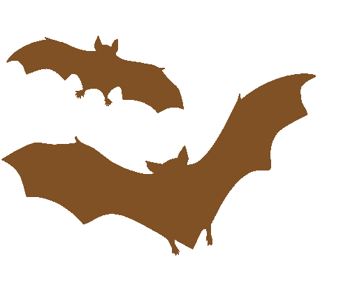

## Olá! 

Eu sou o Moa.

 

- 👨‍💻 Analytics Engineer Pleno na <a href="https://www.cacaushow.com.br/">Cacau Show 🤎</a>
- 🎓 Engenharia da Computação (Graduação)
- 🎓 MBA em Data Science e Analytics (USP)
- 💖 Apaixonado por dados
- 🏆 Amo um desafio
- 🤘🏻 Sempre ouvindo um bom rock

### 🔧 O que eu faço

- **Pipelines no Databricks**: ingestão de ERPs (Protheus, SAP) nas camadas bronze → silver → gold, com cargas incrementais e histórico
- **Modelagem e governança**: Materialized Views documentadas, Unity Catalog e segurança por linha (RLS)
- **Migração de BI**: modelos do Power BI / Microsoft Fabric para **Databricks AI/BI Dashboards**, em versão nativa e em React
- **Qualidade**: Pull Requests com CI/CD, testes e revisão de código Spark/SQL
- **IA no dia a dia**: automação de revisões, documentação e migrações com agentes de IA

### 🧰 Ferramentas

##

<!-- Este bloco carrega o jogo que criamos na automação -->
<picture>
  <source media="(prefers-color-scheme: dark)" srcset="https://raw.githubusercontent.com/moaramos/moaramos/output/pacman-contribution-graph-dark.svg">
  <source media="(prefers-color-scheme: light)" srcset="https://raw.githubusercontent.com/moaramos/moaramos/output/pacman-contribution-graph.svg">
  
</picture>
